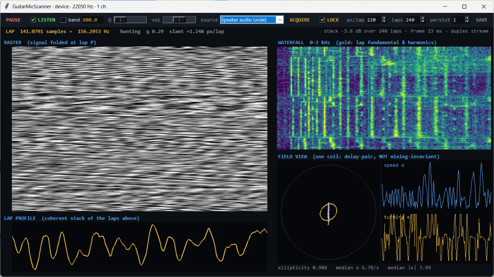
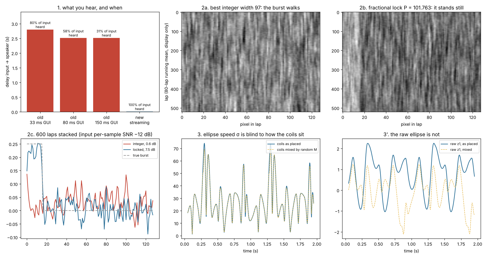

# GuitarMicScanner

*Opus 5.5 (Claude), Nov 26 2026. Built from Antti's Tempest Explorer
(`original/Tempestessss.py`, a guitar pickup with a phone lying on it) and the
Kartiokello ring work ([anttiluode/Kartiokello](https://github.com/anttiluode/Kartiokello)).*



(cellphone playing music - laid on top of guitar coils) 

```
pip install -r requirements.txt
python scanner.py             # pick input/output device, 1 or 2 coils
python scanner.py --demo      # synthetic phone-on-pickup, no hardware needed
python scanner.py --wav rec.wav --channels 2
python bench/bench.py         # the checks below, ~3 s, no hardware
```

## What changed, and why

### 1. You hear it now, not 2.5 s later

In Tempest Explorer, every GUI frame handed the **whole raster window** (the last
~2.5 s) to the sonifier, and the output callback played only the **first 1024
samples** of each queued block. The first samples are the oldest ones. So the
speaker played audio about 2.5 s old, in 46 ms slices, with gaps whenever the GUI
ran slower than ~20 fps.

Here the listening path runs **inside the audio callback**. Each input block goes
through a band filter whose state carries across blocks, then a slow AGC (not
per-block normalising, which pumped), then a soft clip, then straight to the
output. The GUI never touches it. If the host refuses a duplex stream, the
fallback is separate input/output streams passing only *fresh* blocks.

Measured with an exact ramp test (`bench.py` part 1: input sample *i* has value
*i*, so the output says exactly what is played and when):

| path | delay input → speaker | share of input actually heard |
|---|---|---|
| old, GUI at 33 ms/frame | **2.80 s** | 80% (the speaker is busy, but repeats) |
| old, GUI at 80 ms/frame | **2.52 s** | 58% |
| old, GUI at 150 ms/frame | **2.52 s** | 31% |
| **new, streaming** | **0.012 s** (one 256-sample block) | **99.6%** |

The band filter costs ~39 µs per 256-sample block. The display loop is pure
numpy + Tk images (no matplotlib redraws) at ~10 fps, taking 37–44 ms per frame
for all four panels on the test machine.

### 2. The raster is a ring, and it locks

The raster folds the signal at a lap P. Integer widths can't match a GSM frame
(22050 / 216.68 = **101.763** samples), so the picture always slants. Now the lap
is **fractional** and locked in two steps:

- **ACQUIRE**: a harmonic comb over the last 3 s finds the fundamental in the
  profile's range.
- **LOCK**: a phase-lock loop on the lap. Laps are first averaged in short groups
  so the slant is visible even when one lap is buried in noise. The slant between
  groups is measured by cross-spectrum, with a long baseline near lock for
  sub-pixel precision. P is pulled into step with the source. This is the
  "query ring falls into step" of Kartiokello exp7, as a PLL.

Synthetic GSM buzz, one slot in eight, at −12 dB per-sample SNR (`bench.py` part 2):

| | lap | stacked SNR over 600 laps |
|---|---|---|
| best integer width | 97 (the burst walks ~3600 px across 600 laps) | 0.6 dB |
| **acquire + lock** | **101.7635** (true 101.7630, error 5 ppm) | **7.5 dB** |

In the demo the GUI locks at 216.68 Hz in about a second, quality 0.94.
**PERSIST** averages laps for the eye only.

### 3. Two coils → the field ellipse in the hyperbolic plane

With two pickups (Focusrite inputs 1 + 2, coils at roughly 90°), the field near
the phone is a 2D vector. Over a short window (16 ms), its covariance is
`C = area × q̄`, where q̄ has det 1. That q̄ is the **polarisation ellipse** of the
field: a point in H², the same space as the Kartiokello cone texture. Over time
the ellipse traces a path. The panel shows that path on the Poincaré disk, plus
two features read from it:

- **speed σ**: how fast the ellipse changes shape
- **turning κ**: which way it bends

Mixing the two coils by any matrix M (det > 0) maps C → M C Mᵀ, which is an
isometry of H². That covers the phone lying at another angle, coil gain mismatch,
and crosstalk between the coils. **σ and κ do not change; the raw ellipse does.**

`bench.py` part 3: a field with changing polarisation, mixed by 10 random
matrices (condition number 1.2–8.5), plus noise:

| feature | correlation, before vs after mixing |
|---|---|
| speed σ | **0.997** median (worst 0.983) |
| turning κ (where the ellipse moves) | **0.992** median (worst 0.966) |
| raw ellipse coordinate z1 | anywhere from −0.64 to 1.00 |

This is Kartiokello's exp6 (the sweep head survives unknown poses; a lab-frame
reader goes to coin flip), now applied to a physical probe.

With **one coil** the panel shows a delay-pair view, (x(t), x(t − quarter period
of the band)), clearly labelled as not mixing-invariant.

## Ledger

**Verified (synthetic signals, `bench/results.json`):** listening delay and
coverage (table 1); lap lock at 5 ppm with a stacked SNR gain from 0.6 to 7.5 dB
(table 2); σ, κ invariance under coil mixing (table 3); a linearly polarised
field is correctly flagged as degenerate (ellipticity 0.0002). The GUI runs in
demo mode with one and with two coils (screenshot).

**Not yet tested on your hardware:**

- **Duplex audio on Windows with the Focusrite.** sounddevice may refuse a duplex
  stream across host APIs; the fallback path is there, but untested.
- **Whether a real phone's leakage has usable polarisation.** If the field at the
  pickups is essentially linear (one direction, in phase), the ellipse collapses
  to a line at the edge of H². The panel then says so: ellipticity < 0.05 means
  σ/κ are unreliable. Two coils at 90° near a speaker voice coil *might* see an
  elliptical field (two sources, near-field phase differences). That is the first
  thing to measure.
- **Lock range on real signals.** Acquisition searches the profile's frequency
  range. A source drifting faster than the loop can follow will show "hunting".

**Tried and dropped:** a "scale test" (is the loudness envelope scale-free, using
the Kartiokello junction ratio?). On synthetic signals it did not separate a
scale-free envelope from a clocked buzz, so it is not in the app.

## Files

```
scanner.py          entry point
gms/dsp.py          StreamingBand, Ring, fold, row_drift, LapLock, acquire,
                    stack_profile, H2Reader, delay_pair, to_disk, colour LUTs
gms/audio.py        AudioEngine: duplex device stream / fallback, demo, wav
gms/app.py          the GUI (raster, lap profile, waterfall, field ellipse in H²)
bench/bench.py      the three checks above -> bench/bench.png, bench/results.json
original/           Tempest Explorer as it was (Tempestessss.py)
```


